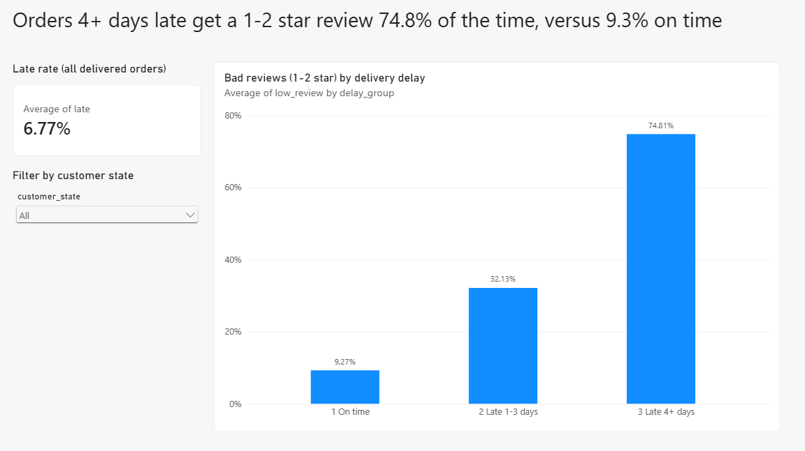
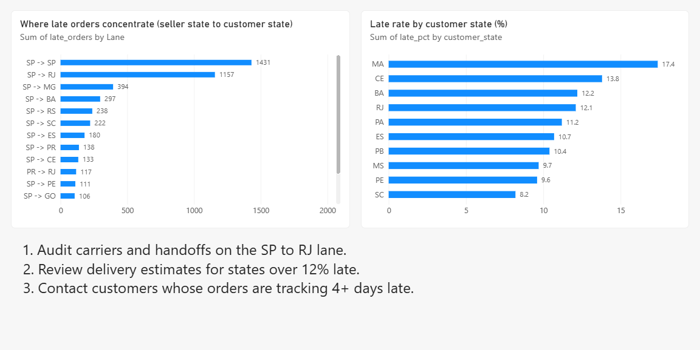

# Olist: Do Late Deliveries Hurt Customer Reviews, and Where Should Olist Fix First?

**Key insight:** Orders delivered 4 or more days late get a 1-2 star review 74.8% of the time, versus 9.3% for on-time orders. After controlling for price, freight, weight and state, lateness adds about 53 percentage points to the chance of a bad review.

**At a glance:** 99,441 orders across 7 tables · 6.8% of delivered orders arrive late · SQL (CTEs, window functions) + Python (confidence intervals, logistic regression, bootstrap) · the late orders are concentrated in a few seller-to-customer lanes, led by Sao Paulo to Rio de Janeiro.

**Dashboard:** 2-page Power BI report (screenshots below).




## Business question

Late deliveries are an operations problem, but their cost shows up in customer reviews. How much do they hurt, is it really the delay or something else, and which lanes should Olist fix first?

## Findings

- 97.0% of orders are delivered. 6.8% of delivered orders arrive after the estimated date.
- **Reviews fall as delays grow.** Average score is 4.29 on time, 3.29 when 1-3 days late, and 1.85 when 4+ days late.
- **The effect holds after controls.** Adjusted for price, freight, product weight, items in the order and customer state, late orders are predicted to get a 1-2 star review 62.4% of the time, against 9.4% if the same orders had arrived on time (bootstrap 95% CI for the gap: +51.7 to +54.2 points).
- **Late orders cluster in specific lanes.** Sao Paulo sellers to Rio de Janeiro customers: 8,274 orders, 14.0% late, and 17.7% of all late seller-order pairs. Sao Paulo to Sao Paulo has the most late orders (1,431) but a low rate (4.6%).
- **Some states are much worse.** Late rate by customer state: Maranhao 17.4%, Ceara 13.8%, Bahia 12.2%, Rio de Janeiro 12.1%, Para 11.2%.
- **Repeat buying is rare, and slightly lower after a very late first order.** Only about 3% of customers ordered more than once. Within 180 days of the first delivery, 1.75% of customers with an on-time first order bought again, versus 1.03% after a first order 4+ days late.
- **Customer value is mostly one-time.** 97.0% of customers bought once. Lapsed high-value one-time buyers are 14.7% of customers and 27.4% of revenue.

## Statistical checks

**Are the review gaps real?** Share of orders with a 1-2 star review (95% Wilson confidence intervals):

| Delivery | Orders | 1-2 star | 95% CI |
|---|---:|---:|---|
| On time | 89,427 | 9.3% | 9.1% to 9.5% |
| Late 1-3 days | 1,852 | 32.1% | 30.0% to 34.3% |
| Late 4+ days | 4,529 | 74.8% | 73.5% to 76.0% |

(The SQL query counts 16 more on-time orders because the regression drops orders with no product weight.)

**Is it just price, freight, weight or location?** A logistic regression controlling for those gives odds ratios versus on-time of 4.9 (95% CI 4.4 to 5.4) for 1-3 days late and 30.1 (28.0 to 32.4) for 4+ days late.

**Does it hold everywhere?** In each of the 8 largest states the gap is positive, from +42.9 points (Parana) to +62.3 points (Distrito Federal). Using only single-item orders, the 4+ days late odds ratio is 35.1 (32.6 to 37.9).

**Do late first orders reduce repeat purchases?** Possibly, but the evidence is thin:

| First order | Customers | Repeat within 180 days | 95% CI |
|---|---:|---:|---|
| On time | 52,207 | 1.75% | 1.64% to 1.87% |
| Late 1-3 days | 1,025 | 1.66% | 1.04% to 2.64% |
| Late 4+ days | 2,802 | 1.03% | 0.72% to 1.48% |

On time versus 4+ days late: p < 0.01 (two-proportion z-test). Adjusted for price, freight and state, late first orders have an odds ratio of 0.72 for repeat buying (95% CI 0.53 to 0.97). Within Sao Paulo only: 2.02% versus 1.36%. Only 29 customers in the 4+ days group came back, so treat this as a signal, not a finding to build on alone.

**Cohort retention is very low.** For every 2017 monthly cohort, fewer than 1% of customers ordered again in any single later month (month 1, 2, 3 or 6).

## Impact sizing (assumption-based, not a forecast)

Six lanes in the top-15 list are late more than 10% of the time. If they matched the overall 6.8% late rate, there would be about 990 fewer late orders. At +53 points of bad-review risk, that is roughly 526 fewer 1-2 star reviews, about 4% of all 1-2 star reviews. This assumes the adjusted effect is causal, which these data cannot prove.

## Recommendations (in priority order)

| # | Action | Where | Evidence | Next step |
|---|---|---|---|---|
| 1 | Audit carriers and handoffs on the Sao Paulo to Rio de Janeiro lane | SP to RJ (8,274 orders) | 14.0% late, 17.7% of all late seller-order pairs | Compare carrier and seller performance inside the lane |
| 2 | Review delivery estimates for the highest-late-rate states and lanes | MA, CE, BA, RJ and the lanes above 10% late | Late rates of 12% to 19% | A/B test longer promised dates against conversion |
| 3 | Contact customers whose orders are tracking 4+ days late | All lanes | 74.8% of these orders get a 1-2 star review | A/B test an apology message or voucher |
| 4 | Review the sellers that cause the most late orders in their state | SP seller 4a3ca931 (1,772 orders, 9.7% late); MA seller 06a2c3af (389 orders, 19.0% late) | See `outputs/05_seller_rank_in_state.csv` | Check whether the delay is at the seller or the carrier |

## Method

- **SQL (SQLite):** a single `order_facts` table (one row per delivered order) built with CTEs and `ROW_NUMBER()`, then queries for review score by delay, late rate by state with `RANK()`, worst lanes, sellers ranked within state, repeat purchase, cohort retention and RFM segments. Repeat purchase uses `customer_unique_id` (the `customer_id` changes on every order), requires the repeat order to be placed after the first delivery, and only counts customers who could be observed for the full 180 days.
- **Python:** Wilson confidence intervals, logistic regression with state and product controls, a bootstrap CI for the adjusted effect (100 resamples), within-state and single-item robustness checks, a z-test, and the impact sizing.
- **Delay definition:** delivered date minus estimated date, compared at date level. Late means after the estimated date.
- **Power BI:** a 2-page dashboard showing bad reviews by delivery delay and where late orders concentrate.

## Data

Kaggle: [Brazilian E-Commerce Public Dataset by Olist](https://www.kaggle.com/datasets/olistbr/brazilian-ecommerce) (about 100K orders, 2016 to 2018). Seven of the nine files are used (the geolocation file is not needed).

## How to reproduce

```bash
pip install -r requirements.txt
# download the Olist CSVs from Kaggle into data/raw/
python run_sql.py      # loads SQLite, runs sql/*.sql, writes outputs/*.csv
python analysis.py     # statistics, charts in images/, outputs/analysis_results.txt
```

## Repo layout

```text
.
├── README.md
├── requirements.txt
├── run_sql.py
├── analysis.py
├── sql/            numbered queries, 00 builds the base table
├── outputs/        result tables and analysis_results.txt
├── images/         charts used in this README
└── data/raw/       Olist CSVs (not committed, see .gitignore)
```

## Limits

- These are associations, not proof of cause. Lateness is measured against Olist's own estimate, so the data cannot separate "late" from "slow".
- Product category is not controlled for (product weight is used as a rough proxy), and other drivers such as seller quality could matter.
- Reviews are voluntary, so they reflect customers who chose to review.
- Only about 3% of customers ordered twice, so repeat-purchase results rest on small counts.
- Lanes are seller state to customer state (a coarse level), and lane counts are seller-order pairs, so the sizing is approximate.
- Historical snapshot of one marketplace from 2016 to 2018.

## Next step

Run an A/B test of the late-order contact (recommendation 3) to measure how much of the review damage can actually be recovered.
